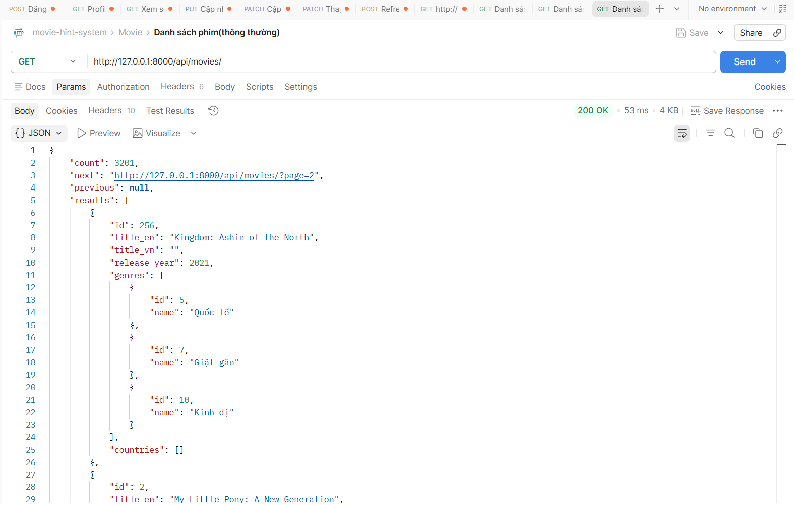
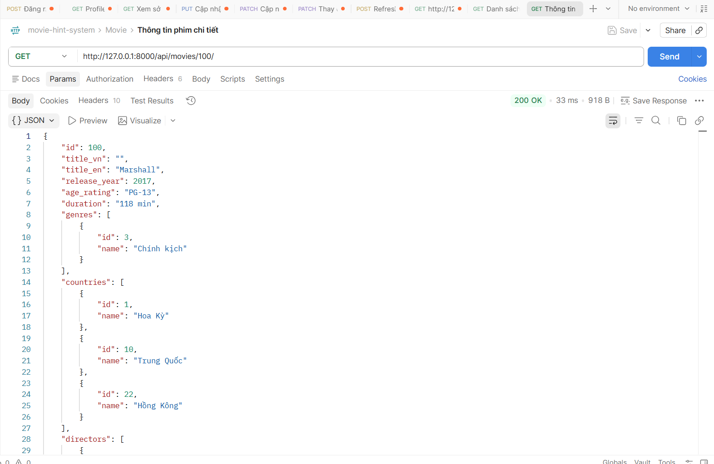

# API CURD MOVIES
## Xem phim:
### Xem danh sách phim
1. Mô tả:
- Đây là api dùng cho mục đích xem danh sách phim

2. Endpoint - Method:
- GET api/movies/

3. Input/output data:
- Output:
{
    "count": 3201,
    "next": "http://127.0.0.1:8000/api/movies/?page=2",
    "previous": null,
    "results": [
        {
            "id": 256,
            "title_en": "Kingdom: Ashin of the North",
            "title_vn": "",
            "release_year": 2021,
            "genres": [
                {
                    "id": 5,
                    "name": "Quốc tế"
                },
                {
                    "id": 7,
                    "name": "Giật gân"
                },
                {
                    "id": 10,
                    "name": "Kinh dị"
                }
            ],
            "countries": []
        },
        {
            "id": 2,
            "title_en": "My Little Pony: A New Generation",
            "title_vn": "",
            "release_year": 2021,
            "genres": [
                {
                    "id": 2,
                    "name": "Thiếu nhi & gia đình"
                }
            ],
            "countries": []
        },
        {
            "id": 782,
            "title_en": "The Yin Yang Master",
            "title_vn": "",
            "release_year": 2021,
            "genres": [
                {
                    "id": 5,
                    "name": "Quốc tế"
                },
                {
                    "id": 12,
                    "name": "Hành động & phiêu lưu"
                }
            ],
            "countries": [
                {
                    "id": 10,
                    "name": "Trung Quốc"
                }
            ]
        },
    ]
}

### Xem chi tiết phim
1. Mô tả:
- Đây là api dùng cho mục đích xem chi tiết sự kiện

2. Endpoint - Method:
- GET api/movies/{id} 

3. Input/output data:
- Output: 
{
    "id": 100,
    "title_vn": "",
    "title_en": "Marshall",
    "release_year": 2017,
    "age_rating": "PG-13",
    "duration": "118 min",
    "genres": [
        {
            "id": 3,
            "name": "Chính kịch"
        }
    ],
    "countries": [
        {
            "id": 1,
            "name": "Hoa Kỳ"
        },
        {
            "id": 10,
            "name": "Trung Quốc"
        },
        {
            "id": 22,
            "name": "Hồng Kông"
        }
    ],
    "directors": [
        {
            "id": 88,
            "name": "Reginald Hudlin"
        }
    ],
    "actors": [
        {
            "id": 765,
            "name": "Chadwick Boseman"
        }
    ],
    "platforms": [
        {
            "id": 1,
            "name": "Netflix"
        }
    ],
    "poster": null,
    "description_vn": "",
    "description_en": "This biopic of Thurgood Marshall, the first Black U.S. Supreme Court justice, centers on his pivotal work in a sensational case as an NAACP lawyer."
}
 