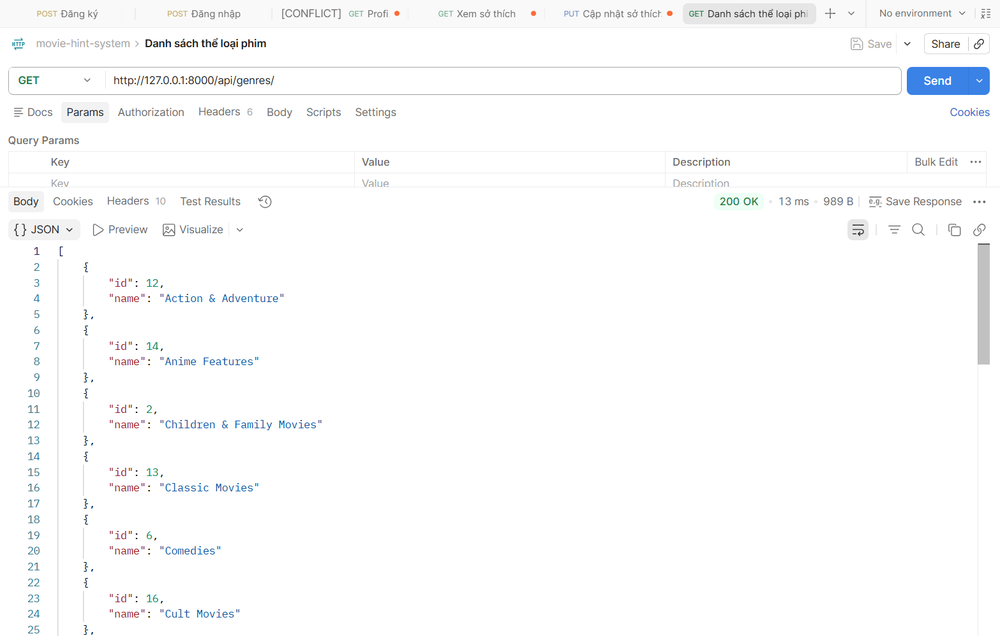
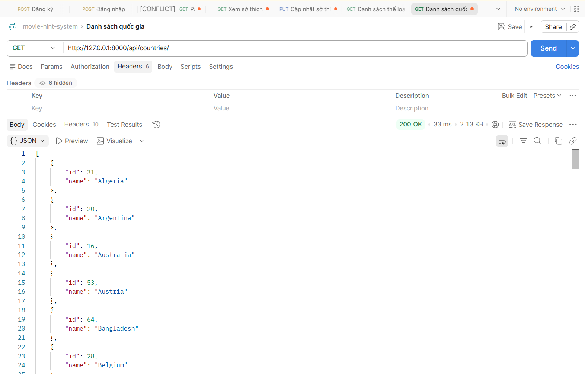

# API thông tin phim
## Danh sách thể loại phim
1. Mô tả:
- Đây là api dùng cho phép xem danh sách thể loại
- Không cần đăng nhập

2. Endpoint - Method: GET /api/genres/
3. Input/output data:
- output example:
[
    {
        "id": 12,
        "name": "Action & Adventure"
    },
    {
        "id": 14,
        "name": "Anime Features"
    },
    {
        "id": 2,
        "name": "Children & Family Movies"
    },
    {
        "id": 13,
        "name": "Classic Movies"
    },
    {
        "id": 6,
        "name": "Comedies"
    },
    {
        "id": 16,
        "name": "Cult Movies"
    },
    {
        "id": 1,
        "name": "Documentaries"
    },
    {
        "id": 3,
        "name": "Dramas"
    },
    {
        "id": 17,
        "name": "Faith & Spirituality"
    },
    {
        "id": 10,
        "name": "Horror Movies"
    },
    {
        "id": 4,
        "name": "Independent Movies"
    },
    {
        "id": 5,
        "name": "International Movies"
    },
    {
        "id": 18,
        "name": "LGBTQ Movies"
    },
    {
        "id": 20,
        "name": "Movies"
    },
    {
        "id": 9,
        "name": "Music & Musicals"
    },
    {
        "id": 8,
        "name": "Romantic Movies"
    },
    {
        "id": 11,
        "name": "Sci-Fi & Fantasy"
    },
    {
        "id": 15,
        "name": "Sports Movies"
    },
    {
        "id": 19,
        "name": "Stand-Up Comedy"
    },
    {
        "id": 7,
        "name": "Thrillers"
    }
]

## Danh sách quốc gia
1. Mô tả:
- Đây là api dùng cho phép xem danh sách quốc gia 
- Không cần đăng nhập

2. Endpoint - Method: GET /api/countries/
3. Input/output data:
- output example:
[
    {
        "id": 31,
        "name": "Algeria"
    },
    {
        "id": 20,
        "name": "Argentina"
    },
    {
        "id": 16,
        "name": "Australia"
    },
    {
        "id": 53,
        "name": "Austria"
    },
    {
        "id": 64,
        "name": "Bangladesh"
    },
    {
        "id": 28,
        "name": "Belgium"
    },
    {
        "id": 25,
        "name": "Brazil"
    },
    {
        "id": 30,
        "name": "Bulgaria"
    },
    {
        "id": 3,
        "name": "Burkina Faso"
    },
    {
        "id": 63,
        "name": "Cambodia"
    },
    {
        "id": 57,
        "name": "Cameroon"
    },
    {
        "id": 11,
        "name": "Canada"
    },
    {
        "id": 66,
        "name": "Cayman Islands"
    },
    {
        "id": 61,
        "name": "Chile"
    },
    {
        "id": 10,
        "name": "China"
    },
    {
        "id": 27,
        "name": "Colombia"
    },
    {
        "id": 7,
        "name": "Czech Republic"
    },
    {
        "id": 38,
        "name": "Denmark"
    },
    {
        "id": 37,
        "name": "Egypt"
    },
    {
        "id": 6,
        "name": "Ethiopia"
    },
    {
        "id": 9,
        "name": "France"
    },
    {
        "id": 5,
        "name": "Germany"
    },
    {
        "id": 2,
        "name": "Ghana"
    },
    {
        "id": 26,
        "name": "Greece"
    },
    {
        "id": 22,
        "name": "Hong Kong"
    },
    {
        "id": 45,
        "name": "Hungary"
    },
    {
        "id": 8,
        "name": "India"
    },
    {
        "id": 36,
        "name": "Indonesia"
    },
    {
        "id": 59,
        "name": "Ireland"
    },
    {
        "id": 33,
        "name": "Israel"
    },
    {
        "id": 18,
        "name": "Italy"
    },
    {
        "id": 13,
        "name": "Japan"
    },
    {
        "id": 60,
        "name": "Kenya"
    },
    {
        "id": 39,
        "name": "Kuwait"
    },
    {
        "id": 46,
        "name": "Lebanon"
    },
    {
        "id": 42,
        "name": "Malaysia"
    },
    {
        "id": 52,
        "name": "Mauritius"
    },
    {
        "id": 17,
        "name": "Mexico"
    },
    {
        "id": 23,
        "name": "Nepal"
    },
    {
        "id": 40,
        "name": "Netherlands"
    },
    {
        "id": 24,
        "name": "New Zealand"
    },
    {
        "id": 14,
        "name": "Nigeria"
    },
    {
        "id": 67,
        "name": "Norway"
    },
    {
        "id": 58,
        "name": "Palestine"
    },
    {
        "id": 48,
        "name": "Philippines"
    },
    {
        "id": 32,
        "name": "Poland"
    },
    {
        "id": 65,
        "name": "Portugal"
    },
    {
        "id": 51,
        "name": "Qatar"
    },
    {
        "id": 19,
        "name": "Romania"
    },
    {
        "id": 55,
        "name": "Russia"
    },
    {
        "id": 34,
        "name": "Saudi Arabia"
    },
    {
        "id": 41,
        "name": "Singapore"
    },
    {
        "id": 12,
        "name": "South Africa"
    },
    {
        "id": 43,
        "name": "South Korea"
    },
    {
        "id": 15,
        "name": "Spain"
    },
    {
        "id": 50,
        "name": "Sweden"
    },
    {
        "id": 29,
        "name": "Switzerland"
    },
    {
        "id": 47,
        "name": "Syria"
    },
    {
        "id": 56,
        "name": "Taiwan"
    },
    {
        "id": 35,
        "name": "Thailand"
    },
    {
        "id": 54,
        "name": "Turkey"
    },
    {
        "id": 49,
        "name": "United Arab Emirates"
    },
    {
        "id": 4,
        "name": "United Kingdom"
    },
    {
        "id": 1,
        "name": "United States"
    },
    {
        "id": 62,
        "name": "Uruguay"
    },
    {
        "id": 21,
        "name": "Venezuela"
    },
    {
        "id": 44,
        "name": "Vietnam"
    }
]

