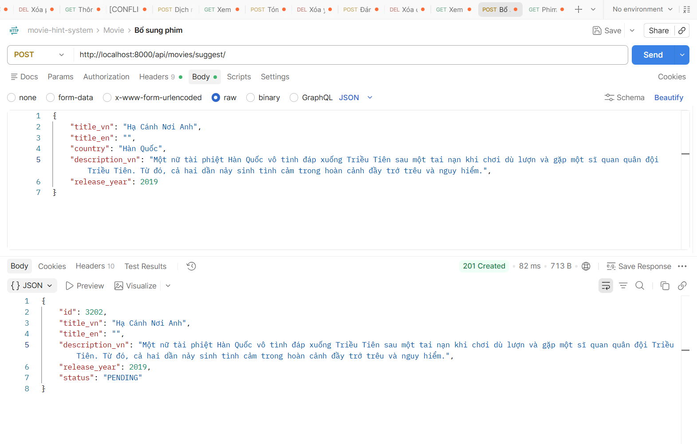
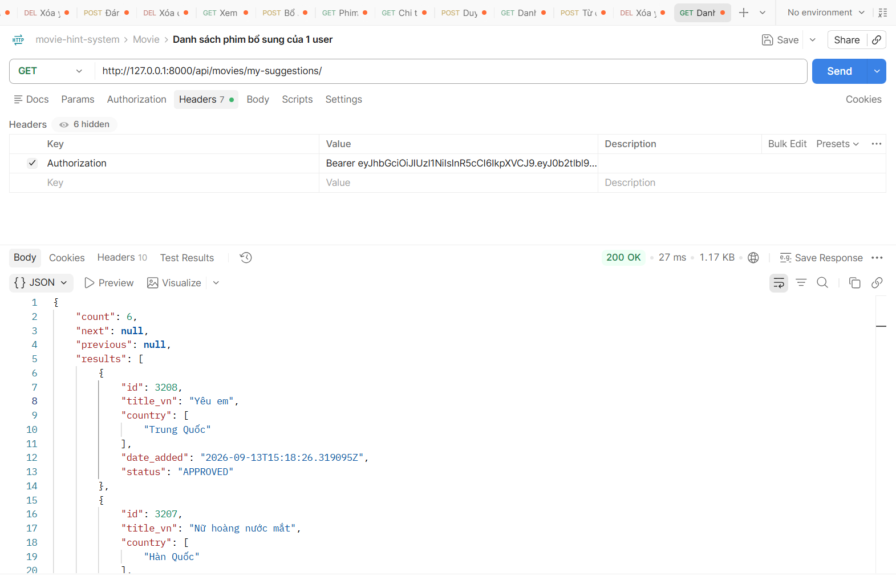
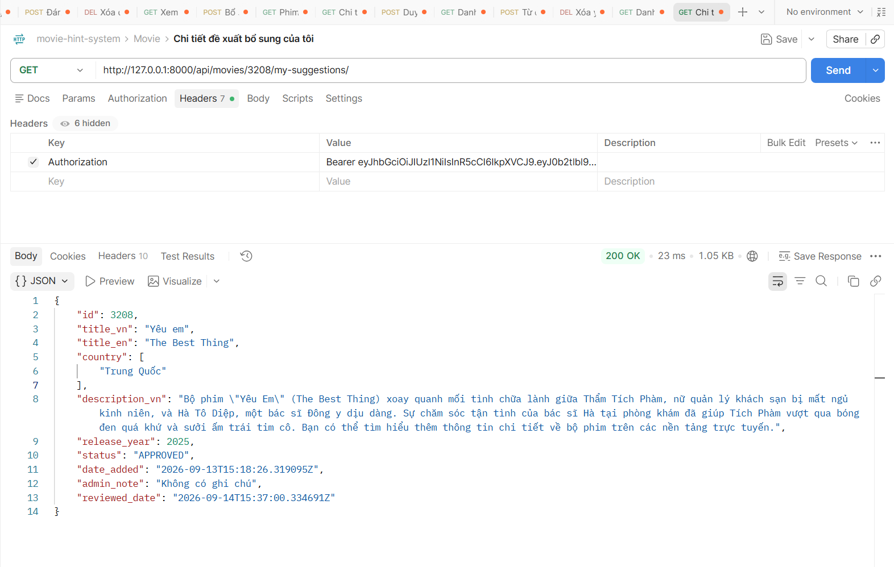
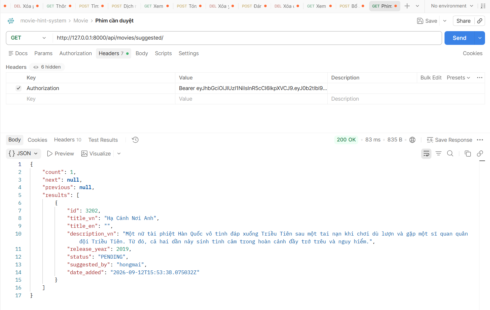
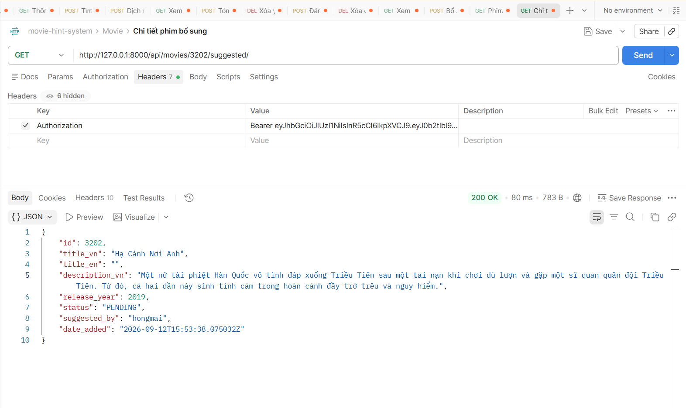
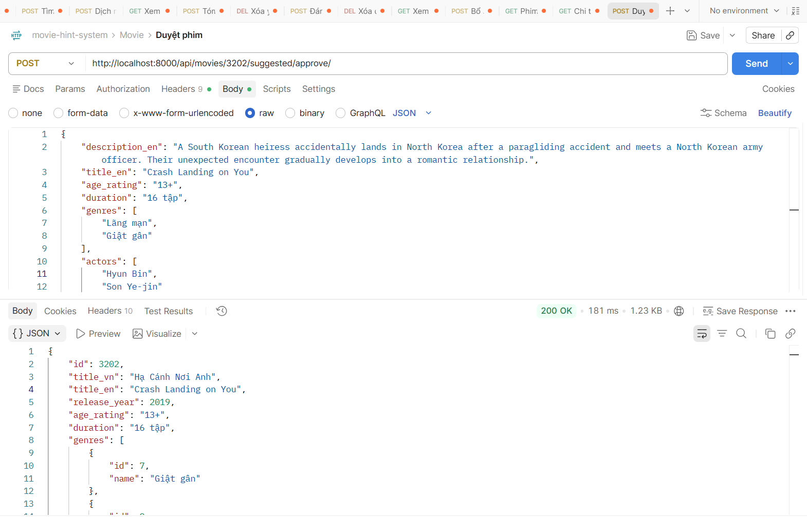
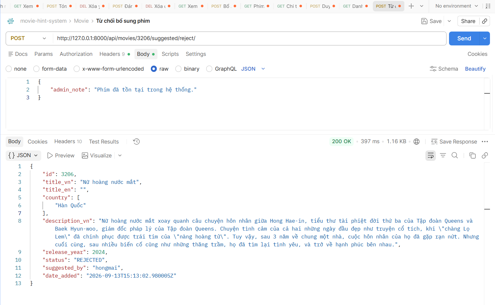
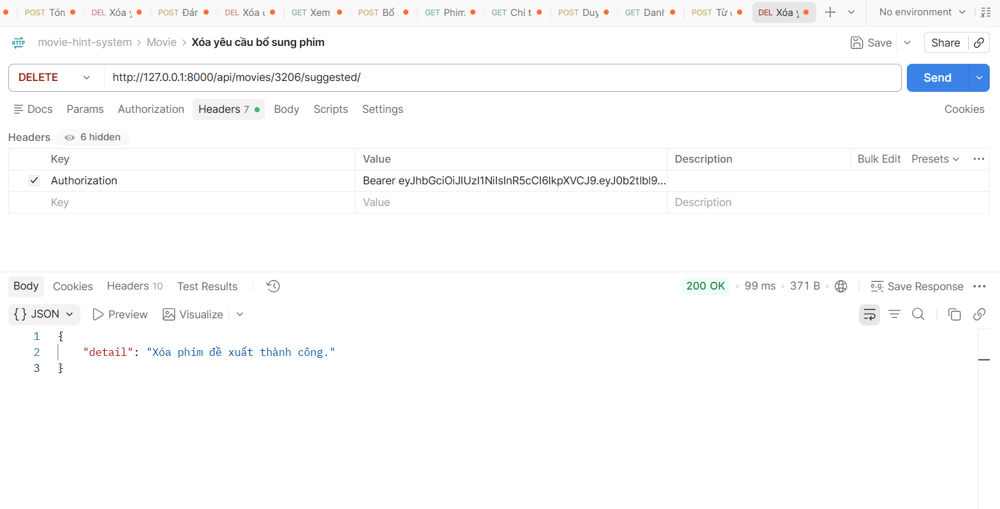

# API SUGGESTION
## Đề xuất bổ sung phim
1. Mô tả:
- Đây là api dùng cho mục đích đề xuất bổ sung phim vào hệ thống

2. Endpoint - Method:
- POST http://localhost:8000/api/movies/suggest/

3. Input/output data:
- Input:
{
    "title_vn": "Hạ Cánh Nơi Anh",
    "title_en": "",
    "country": "Hàn Quốc",
    "description_vn": "Một nữ tài phiệt Hàn Quốc vô tình đáp xuống Triều Tiên sau một tai nạn khi chơi dù lượn và gặp một sĩ quan quân đội Triều Tiên. Từ đó, cả hai dần nảy sinh tình cảm trong hoàn cảnh đầy trớ trêu và nguy hiểm.",
    "release_year": 2019
}

- Output:
{
    "id": 3202,
    "title_vn": "Hạ Cánh Nơi Anh",
    "title_en": "",
    "description_vn": "Một nữ tài phiệt Hàn Quốc vô tình đáp xuống Triều Tiên sau một tai nạn khi chơi dù lượn và gặp một sĩ quan quân đội Triều Tiên. Từ đó, cả hai dần nảy sinh tình cảm trong hoàn cảnh đầy trớ trêu và nguy hiểm.",
    "release_year": 2019,
    "status": "PENDING"
}

## Danh sách phim đề xuất của 1 user
1. Mô tả:
- Đây là api dùng cho mục đích xem phim bổ sung của 1 user 

2. Endpoint - Method:
- GET http://127.0.0.1:8000/api/movies/my-suggestions/

3. Input/output data:
- Output:
{
    "count": 6,
    "next": null,
    "previous": null,
    "results": [
        {
            "id": 3208,
            "title_vn": "Yêu em",
            "country": [
                "Trung Quốc"
            ],
            "date_added": "2026-09-13T15:18:26.319095Z",
            "status": "APPROVED"
        },
        {
            "id": 3207,
            "title_vn": "Nữ hoàng nước mắt",
            "country": [
                "Hàn Quốc"
            ],
            "date_added": "2026-09-13T15:13:45.921615Z",
            "status": "APPROVED"
        },
        {
            "id": 3205,
            "title_vn": "Nữ hoàng nước mắt",
            "country": [
                "Hàn Quốc"
            ],
            "date_added": "2026-09-13T15:11:35.916921Z",
            "status": "PENDING"
        },
        {
            "id": 3204,
            "title_vn": "Nữ hoàng nước mắt",
            "country": [
                "Hàn Quốc"
            ],
            "date_added": "2026-09-13T15:11:23.680076Z",
            "status": "PENDING"
        },
        {
            "id": 3203,
            "title_vn": "Hạ Cánh Nơi Anh",
            "country": [
                "Trung Quốc",
                "Hàn Quốc"
            ],
            "date_added": "2026-09-13T09:20:50.122996Z",
            "status": "PENDING"
        },
        {
            "id": 3202,
            "title_vn": "Hạ Cánh Nơi Anh",
            "country": [
                "Hàn Quốc"
            ],
            "date_added": "2026-09-12T15:53:38.075032Z",
            "status": "APPROVED"
        }
    ]
}

## Chi tiết phim đề xuất của 1 user
1. Mô tả:
- Đây là api dùng cho mục đích xem thông tin chi tiết phim bổ sung của 1 user 

2. Endpoint - Method:
- GET http://127.0.0.1:8000/api/movies/3208/my-suggestions/

3. Input/output data:
- Output:
{
    "id": 3208,
    "title_vn": "Yêu em",
    "title_en": "The Best Thing",
    "country": [
        "Trung Quốc"
    ],
    "description_vn": "Bộ phim \"Yêu Em\" (The Best Thing) xoay quanh mối tình chữa lành giữa Thẩm Tích Phàm, nữ quản lý khách sạn bị mất ngủ kinh niên, và Hà Tô Diệp, một bác sĩ Đông y dịu dàng. Sự chăm sóc tận tình của bác sĩ Hà tại phòng khám đã giúp Tích Phàm vượt qua bóng đen quá khứ và sưởi ấm trái tim cô. Bạn có thể tìm hiểu thêm thông tin chi tiết về bộ phim trên các nền tảng trực tuyến.",
    "release_year": 2025,
    "status": "APPROVED",
    "date_added": "2026-09-13T15:18:26.319095Z",
    "admin_note": "Không có ghi chú",
    "reviewed_date": "2026-09-14T15:37:00.334691Z"
}

## Danh sách phim cần phê duyệt
1. Mô tả:
- Đây là api dùng cho mục đích hiển thị danh sách phim được user để xuất và cần phê duyệt

2. Endpoint - Method:
- GET http://127.0.0.1:8000/api/movies/suggested/

3. Input/output data:
- Output:
{
    "count": 1,
    "next": null,
    "previous": null,
    "results": [
        {
            "id": 3202,
            "title_vn": "Hạ Cánh Nơi Anh",
            "title_en": "",
            "description_vn": "Một nữ tài phiệt Hàn Quốc vô tình đáp xuống Triều Tiên sau một tai nạn khi chơi dù lượn và gặp một sĩ quan quân đội Triều Tiên. Từ đó, cả hai dần nảy sinh tình cảm trong hoàn cảnh đầy trớ trêu và nguy hiểm.",
            "release_year": 2019,
            "status": "PENDING",
            "suggested_by": "hongmai",
            "date_added": "2026-09-12T15:53:38.075032Z"
        }
    ]
}

## Chi tiết phim cần phê duyệt
1. Mô tả:
- Đây là api dùng cho mục đích hiển thị danh sách phim được user để xuất và cần phê duyệt

2. Endpoint - Method:
- GET http://127.0.0.1:8000/api/movies/3202/suggested/

3. Input/output data:
- Output:
{
    "id": 3203,
    "title_vn": "Hạ Cánh Nơi Anh",
    "title_en": "Crash landing on you",
    "country": [
        "Trung Quốc",
        "Hàn Quốc"
    ],
    "description_vn": "Một nữ tài phiệt Hàn Quốc vô tình đáp xuống Triều Tiên sau một tai nạn khi chơi dù lượn và gặp một sĩ quan quân đội Triều Tiên. Từ đó, cả hai dần nảy sinh tình cảm trong hoàn cảnh đầy trớ trêu và nguy hiểm.",
    "release_year": 2019,
    "status": "PENDING",
    "suggested_by": "hongmai",
    "date_added": "2026-09-13T09:20:50.122996Z"
}

## Duyệt phim bổ sung
1. Mô tả:
- Đây là api dùng cho mục đích duyệt phim được user để xuất bổ sung

2. Endpoint - Method:
- POST http://localhost:8000/api/movies/3202/suggested/approve/

3. Input/output data:
- Input:
{
    "description_en": "A South Korean heiress accidentally lands in North Korea after a paragliding accident and meets a North Korean army officer. Their unexpected encounter gradually develops into a romantic relationship.",
    "title_en": "Crash Landing on You",
    "age_rating": "13+",
    "duration": "16 tập",
    "genres": [
        "Lãng mạn",
        "Giật gân"
    ],
    "actors": [
        "Hyun Bin",
        "Son Ye-jin"
    ],
    "directors": [
        "Lee Jung-hyo"
    ],
    "platforms": [
        "Netflix"
    ],
    "admin_note": "Đã kiểm tra và bổ sung đầy đủ thông tin phim."
}
- Output:
{
    "id": 3202,
    "title_vn": "Hạ Cánh Nơi Anh",
    "title_en": "Crash Landing on You",
    "release_year": 2019,
    "age_rating": "13+",
    "duration": "16 tập",
    "genres": [
        {
            "id": 7,
            "name": "Giật gân"
        },
        {
            "id": 8,
            "name": "Lãng mạn"
        }
    ],
    "countries": [
        {
            "id": 43,
            "name": "Hàn Quốc"
        }
    ],
    "directors": [
        {
            "id": 939,
            "name": "Lee Jung-hyo"
        }
    ],
    "actors": [
        {
            "id": 6551,
            "name": "Hyun Bin"
        },
        {
            "id": 6552,
            "name": "Son Ye-jin"
        }
    ],
    "platforms": [
        {
            "id": 1,
            "name": "Netflix"
        }
    ],
    "poster": null,
    "description_vn": "Một nữ tài phiệt Hàn Quốc vô tình đáp xuống Triều Tiên sau một tai nạn khi chơi dù lượn và gặp một sĩ quan quân đội Triều Tiên. Từ đó, cả hai dần nảy sinh tình cảm trong hoàn cảnh đầy trớ trêu và nguy hiểm.",
    "description_en": "A South Korean heiress accidentally lands in North Korea after a paragliding accident and meets a North Korean army officer. Their unexpected encounter gradually develops into a romantic relationship."
}

## Từ chối duyệt phim bổ sung
1. Mô tả:
- Đây là api dùng cho mục đích từ chối duyệt phim được user để xuất bổ sung

2. Endpoint - Method:
- POST http://127.0.0.1:8000/api/movies/3206/suggested/reject/

3. Input/output data:
- Input:
{
    "admin_note": "Phim đã tồn tại trong hệ thống."
}
- Output:
{
    "id": 3206,
    "title_vn": "Nữ hoàng nước mắt",
    "title_en": "",
    "country": [
        "Hàn Quốc"
    ],
    "description_vn": "Nữ hoàng nước mắt xoay quanh câu chuyện hôn nhân giữa Hong Hae-in, tiểu thư tài phiệt đời thứ ba của Tập đoàn Queens và Baek Hyun-woo, giám đốc pháp lý của Tập đoàn Queens. Chuyện tình cảm của cả hai những ngày đầu đẹp như truyện cổ tích, khi \"chàng Lọ Lem\" đã chinh phục được trái tim của \"nàng hoàng tử\". Tuy vậy, sau 3 năm về chung một nhà, cuộc hôn nhân của họ đã gặp rạn nứt. Nhưng cuối cùng, sau nhiều biến cố cũng như những thăng trầm, họ đã tìm lại tình yêu, và trở về hạnh phúc bên nhau.",
    "release_year": 2024,
    "status": "REJECTED",
    "suggested_by": "hongmai",
    "date_added": "2026-09-13T15:13:02.980005Z"
}

## Xóa đề xuất phim bổ sung
1. Mô tả:
- Đây là api dùng cho mục đích xóa phim được user để xuất bổ sung khi đã bị từ chối (status=REJECTED)

2. Endpoint - Method:
- DELETE http://127.0.0.1:8000/api/movies/3206/suggested/

3. Input/output data:
- Output:
{
    "detail": "Xóa phim đề xuất thành công."
}

