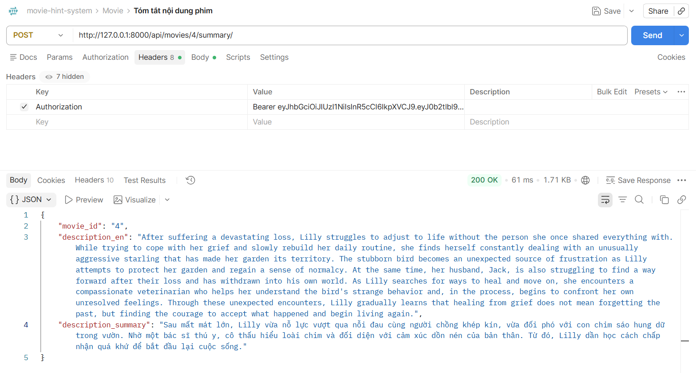

# API TRANSLATE
## Dịch nội dung phim
1. Mô tả:
- Đây là api dùng cho mục đích tóm tắt nội dung phim từ tiếng Anh sang tiếng Việt

2. Endpoint - Method:
- POST api/movies/{movie_id}/summary/

3. Input/output data:
- Output:
{
    "movie_id": "4",
    "description_en": "After suffering a devastating loss, Lilly struggles to adjust to life without the person she once shared everything with. While trying to cope with her grief and slowly rebuild her daily routine, she finds herself constantly dealing with an unusually aggressive starling that has made her garden its territory. The stubborn bird becomes an unexpected source of frustration as Lilly attempts to protect her garden and regain a sense of normalcy. At the same time, her husband, Jack, is also struggling to find a way forward after their loss and has withdrawn into his own world. As Lilly searches for ways to heal and move on, she encounters a compassionate veterinarian who helps her understand the bird's strange behavior and, in the process, begins to confront her own unresolved feelings. Through these unexpected encounters, Lilly gradually learns that healing from grief does not mean forgetting the past, but finding the courage to accept what happened and begin living again.",
    "description_summary": "Sau mất mát lớn, Lilly rơi vào khủng hoảng và liên tục bị quấy rầy bởi một chú chim sáo hung dữ trong vườn. Nhờ sự hỗ trợ từ một bác sĩ thú y tận tâm, cô dần đối diện với nỗi đau để chữa lành tổn thương và bắt đầu lại cuộc sống."
}

