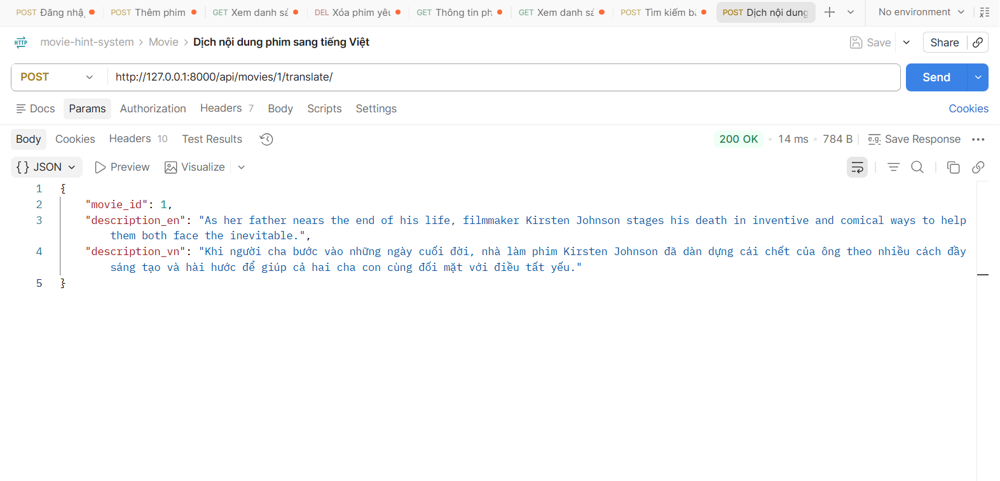

# API TRANSLATE
## Dịch nội dung phim
1. Mô tả:
- Đây là api dùng cho mục đích dịch nội dung phim từ tiếng Anh sang tiếng Việt

2. Endpoint - Method:
- POST api/movies/{movie_id}/translate/

3. Input/output data:
- Output:
{
    "movie_id": 1,
    "description_en": "As her father nears the end of his life, filmmaker Kirsten Johnson stages his death in inventive and comical ways to help them both face the inevitable.",
    "description_vn": "Khi người cha bước vào những ngày cuối đời, nhà làm phim Kirsten Johnson đã dàn dựng cái chết của ông theo nhiều cách đầy sáng tạo và hài hước để giúp cả hai cha con cùng đối mặt với điều tất yếu."
}

