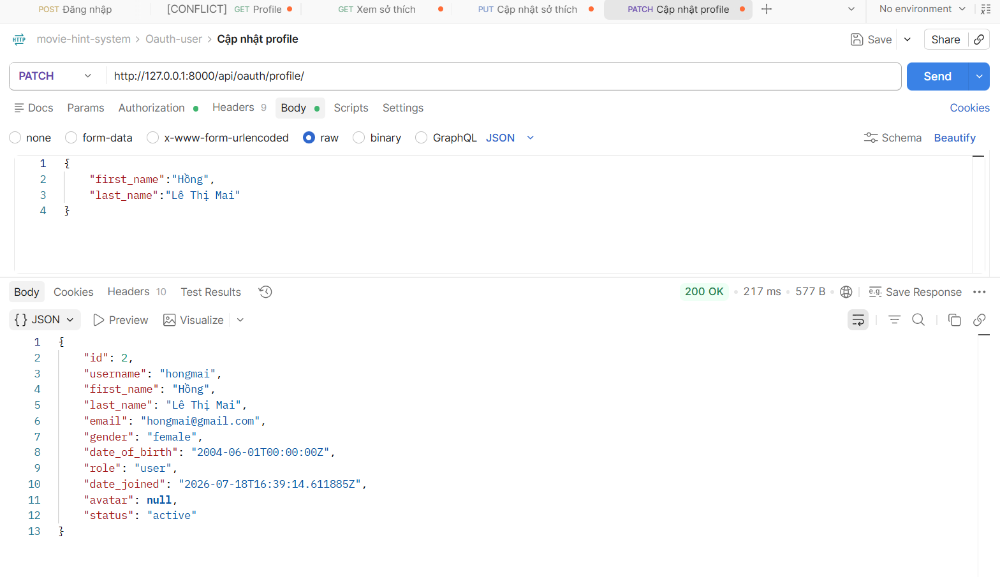
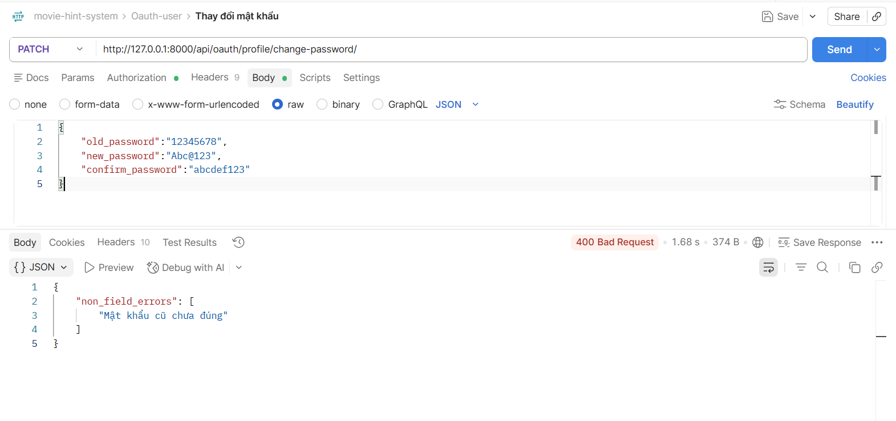
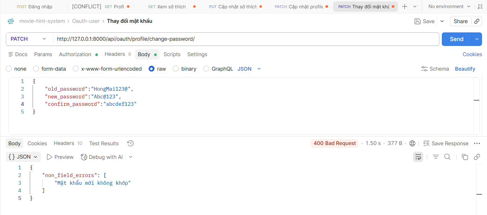
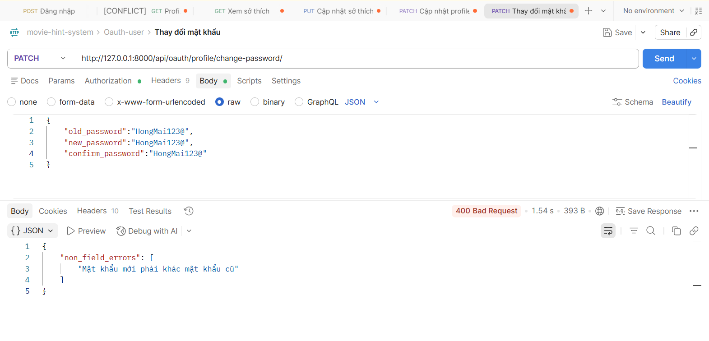
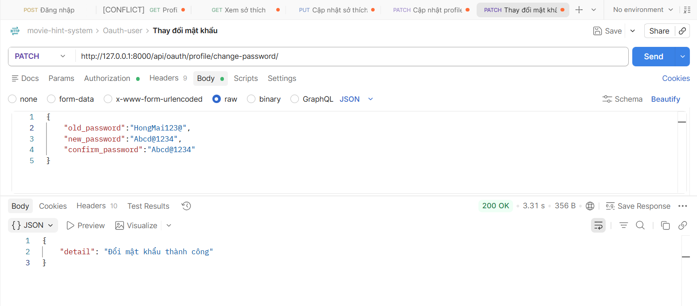

# API CURD CURRENT USER DOCX
## Xem thông tin người dùng
1. Mô tả:
- Đây là api dùng cho mục đích xem thông tin người dùng đang đăng nhập 

2. Endpoint - Method: GET /api/oauth/profile/
3. Input/output data:
- Output:
{
    "id": 2,
    "username": "hongmai",
    "first_name": "",
    "last_name": "",
    "email": "hongmai@gmail.com",
    "gender": "female",
    "date_of_birth": "2004-06-01T00:00:00Z",
    "role": "user",
    "date_joined": "2026-07-18T16:39:14.611885Z",
    "avatar": null,
    "status": "active"
}

-> Lấy thông tin người dùng đang đăng nhập thành công

## Sửa thông tin người dùng
1. Mô tả:
- Đây là api dùng cho mục đích chỉnh sửa thông tin người dùng 

2. Endpoint - Method: 
- PATCH /api/oauth/profile
- PATCH /api/oauth/profile/change-password 

3. Input/output data:
- PATCH /api/oauth/profile
Trường được sửa: [first_name, last_name, avatar]
Input:
{
    "first_name":"Hồng"
}

- PATCH /api/oauth/profile/change-password
(Yêu cầu đầu vào: old_password, new_password, confirm_password)

 -> Mật khẩu cũ chưa đúng 
 -> Mật khẩu mới không khớp 
 -> Mật khẩu mới giống cũ
 -> Đổi mật khẩu thành công

