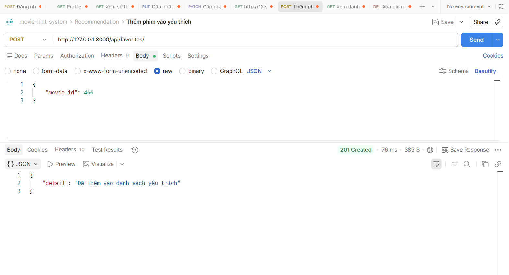
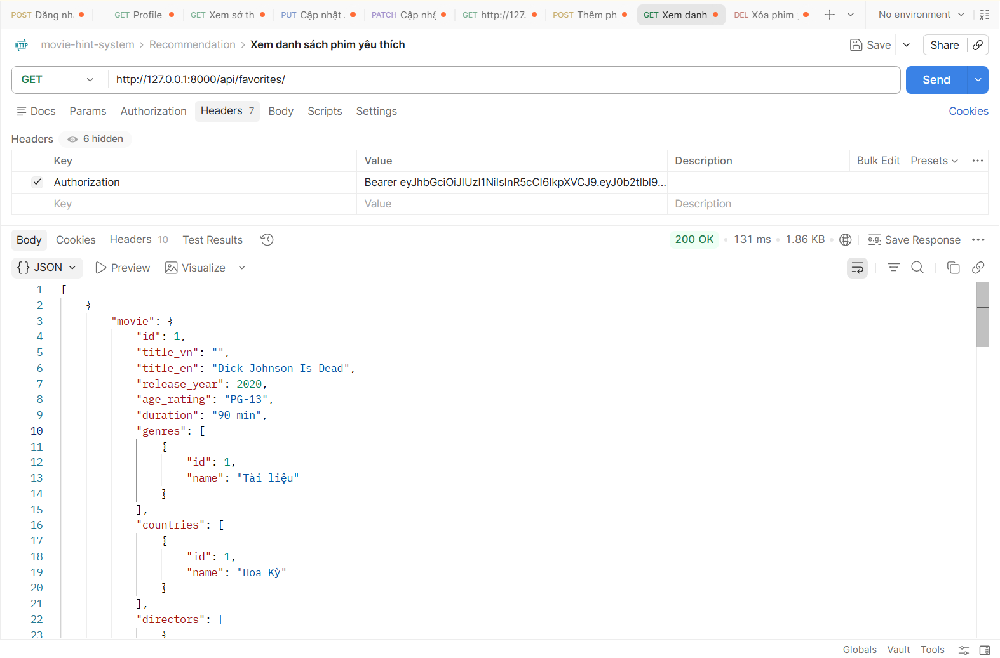
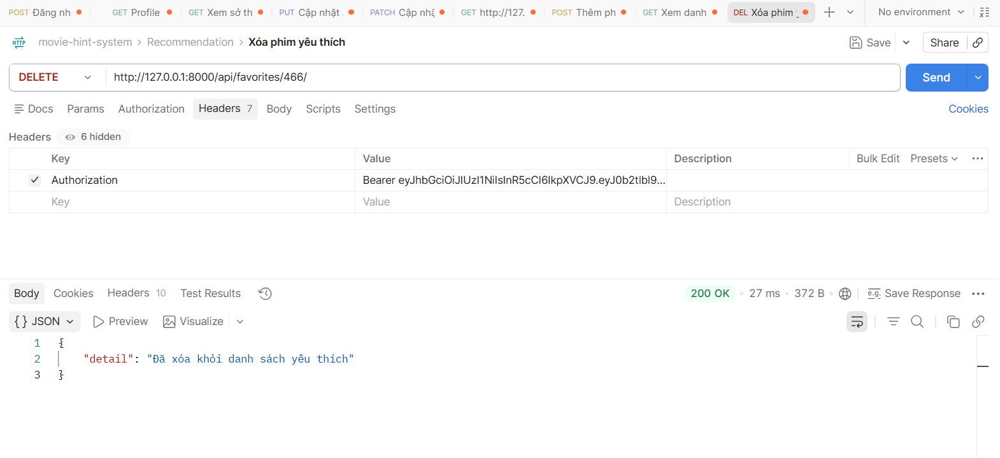

# API FAVORITE
## Xem danh sách yêu thích:

## Thêm yêu thích:
1. Mô tả:
- Đây là api dùng cho mục đích thêm phim vào danh sách yêu thích

2. Endpoint - Method: POST /api/favorites/
3. Input/output data:
- input example:
{
    "movie_id": 466
}

- output example:
{
    "detail": "Đã thêm vào danh sách yêu thích"
}
 

## Xem danh sách yêu thích
1. Mô tả:
- Đây là api dùng cho mục đích xem danh sách các phim yêu thích
- Có phân trang (?page), tìm kiếm theo tên phim/diễn viên (?q), lọc theo query param (?release_year, ?country, ?genre)

2. Endpoint - Method:
- GET /api/favorites/

3. Input/output data:
- Output:
{
    "count": 2,
    "next": null,
    "previous": null,
    "results": [
        {
            "id": 466,
            "title_en": "Camellia Sisters",
            "title_vn": "Gái già lắm chiêu V: Những cuộc đời vương giả",
            "release_year": 2021,
            "genres": [
                {
                    "id": 3,
                    "name": "Chính kịch"
                },
                {
                    "id": 5,
                    "name": "Quốc tế"
                }
            ],
            "countries": [
                {
                    "id": 44,
                    "name": "Việt Nam"
                }
            ],
            "poster": "https://res.cloudinary.com/dvb5t4bfo/image/upload/v1785598674/G%C3%A1i_gi%C3%A0_l%E1%BA%AFm_chi%C3%AAu_V_Nh%E1%BB%AFng_cu%E1%BB%99c_%C4%91%E1%BB%9Di_v%C6%B0%C6%A1ng_gi%E1%BA%A3_poster_glzwv8"
        },
        {
            "id": 1,
            "title_en": "Dick Johnson Is Dead",
            "title_vn": "",
            "release_year": 2020,
            "genres": [
                {
                    "id": 1,
                    "name": "Tài liệu"
                }
            ],
            "countries": [
                {
                    "id": 1,
                    "name": "Hoa Kỳ"
                }
            ],
            "poster": null
        }
    ]
}

 

## Xoá yêu thích:
1. Mô tả:
- Đây là api dùng cho mục đích xóa phim khỏi danh sách yêu thích

2. Endpoint - Method: DELETE /api/favorites/{id}/

3. Input/output data:
- Input: http://127.0.0.1:8000/api/favorites/466/
- Output:
{
    "detail": "Đã xóa khỏi danh sách yêu thích"
}

 -> 