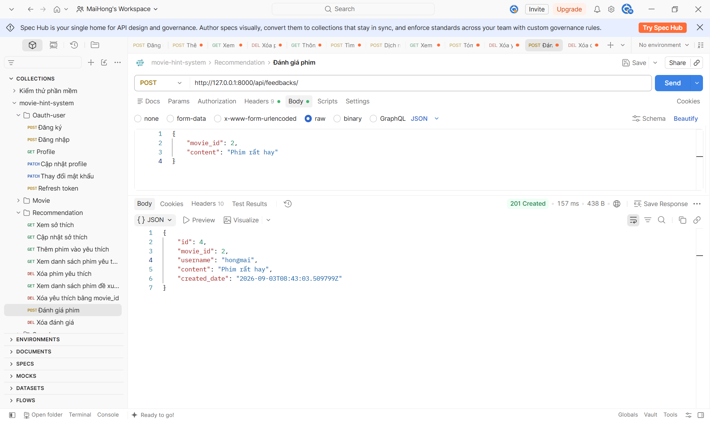
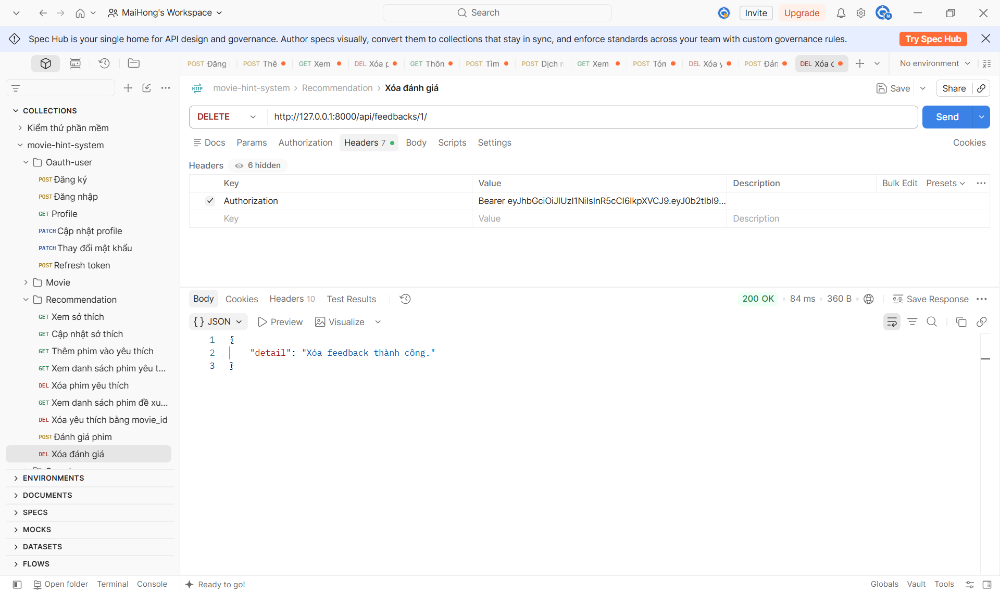

# API FEEDBACK

## Xem danh sách đánh giá:
1. Mô tả:
- Đây là api dùng cho mục đích xem đánh giá của phim.

2. Endpoint - Method: GET http://127.0.0.1:8000/api/feedbacks/?movie_id=1
3. Input/output data:

- output example:
[
    {
        "id": 5,
        "movie_id": 1,
        "username": "lemne",
        "content": "Phim khong hay",
        "created_date": "2026-09-03T21:43:03.509799Z"
    },
    {
        "id": 3,
        "movie_id": 1,
        "username": "hongmai",
        "content": "Phim rất hay",
        "created_date": "2026-09-03T08:41:07.639371Z"
    }
]
 

## Thêm đánh giá:
1. Mô tả:
- Đây là api dùng cho mục đích thêm đánh giá cho phim.

2. Endpoint - Method: POST http://127.0.0.1:8000/api/feedbacks/
3. Input/output data:
- input example:
{
    "movie_id": 2,
    "content": "Phim rất hay"
}

- output example:
{
    "id": 4,
    "movie_id": 2,
    "username": "hongmai",
    "content": "Phim rất hay",
    "created_date": "2026-09-03T08:43:03.509799Z"
}
 

## Xoá đánh giá:
1. Mô tả:
- Đây là api dùng cho mục đích xóa đánh giá phim.

2. Endpoint - Method: DELETE http://127.0.0.1:8000/api/feedbacks/{id}/

3. Input/output data:
- Output:
{
    "detail": "Xóa feedback thành công."
}

 
