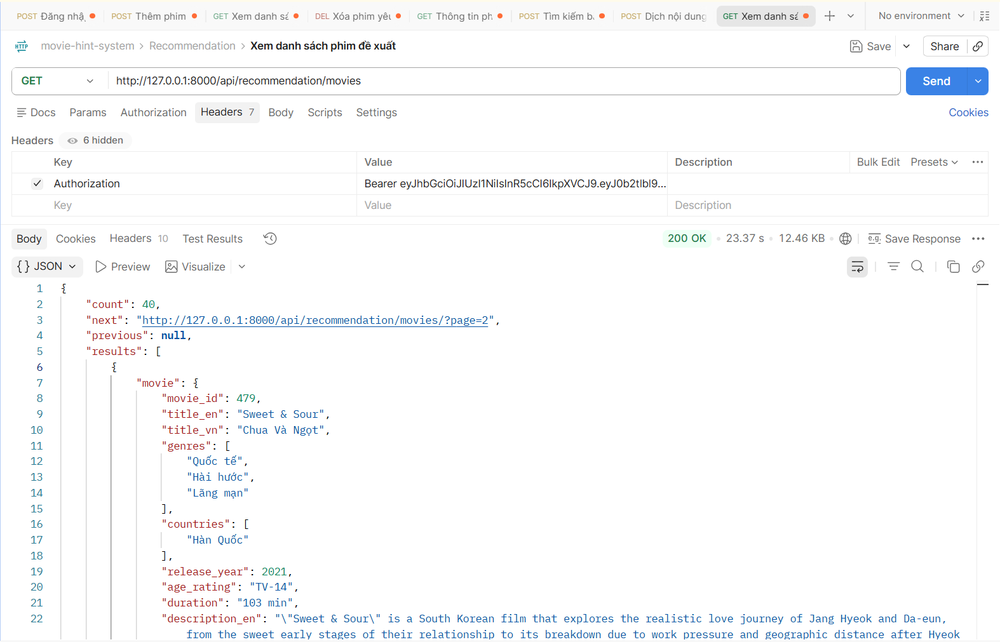

# API RECOMMENDATION
## Xem danh sách phim đề xuất
1. Mô tả:
- Đây là api dùng cho mục đích xem danh sách phim đề xuất theo sở thích và hành vi (có lý do)

2. Endpoint - Method:
- GET api/recommendation/movies/
- Có phân trang (?page), tìm kiếm theo tên phim (?q), lọc theo query param (?release_year, ?country, ?genre)
VD: api/movies/?q=Night in Paradise&country=Hàn Quốc&release_year=2021&page=1

3. Input/output data:
- Output:
{
    "count": 40,
    "next": "http://127.0.0.1:8000/api/recommendation/movies/?page=2",
    "previous": null,
    "results": [
        {
            "movie": {
                "movie_id": 479,
                "title_en": "Sweet & Sour",
                "title_vn": "Chua Và Ngọt",
                "genres": [
                    "Quốc tế",
                    "Hài hước",
                    "Lãng mạn"
                ],
                "countries": [
                    "Hàn Quốc"
                ],
                "release_year": 2021,
                "age_rating": "TV-14",
                "duration": "103 min",
                "description_en": "\"Sweet & Sour\" is a South Korean film that explores the realistic love journey of Jang Hyeok and Da-eun, from the sweet early stages of their relationship to its breakdown due to work pressure and geographic distance after Hyeok relocates to Seoul. The highlight of the movie is a surprising twist at the end, revealing that the character Jang Hyeok is actually stitched together from two different men to deceive the audience, thereby exposing selfishness and a lonely ending for a fickle heart.",
                "description_vn": "Sweet & Sour là bộ phim Hàn Quốc khai thác hành trình tình yêu đầy thực tế của cặp đôi Jang Hyeok và Da-eun, từ giai đoạn ngọt ngào lúc mới yêu đến khi rạn nứt vì áp lực công việc và khoảng cách địa lý khi Hyeok chuyển lên Seoul. Điểm nhấn của tác phẩm là cú twist gây bất ngờ ở cuối phim, tiết lộ nhân vật Jang Hyeok thực chất được ghép từ hai người đàn ông khác nhau để đánh lừa khán giả, qua đó phơi bày sự ích kỷ và cái kết cô độc dành cho kẻ thay lòng đổi dạ."
            },
            "score": 0.9445934,
            "reason": "Bộ phim nằm trong danh sách yêu thích của bạn, thuộc các thể loại Quốc tế, Hài hước, Lãng mạn và đến từ Hàn Quốc."
        },
        {
            "movie": {
                "movie_id": 886,
                "title_en": "Space Sweepers",
                "title_vn": "Con Tàu Chiến Thắng",
                "genres": [
                    "Chính kịch",
                    "Quốc tế",
                    "Hành động & phiêu lưu"
                ],
                "countries": [
                    "Hàn Quốc"
                ],
                "release_year": 2021,
                "age_rating": "TV-MA",
                "duration": "138 min",
                "description_en": "Chasing after space debris and faraway dreams in year 2092, four misfits unearth explosive secrets during the attempted trade of a wide-eyed humanoid.",
                "description_vn": "Theo đuổi rác vũ trụ và những giấc mơ xa xôi vào năm 2092, bốn kẻ lạc loài khai quật được những bí mật động trời trong một vụ mua bán một người máy hình người ngây thơ."
            },
            "score": 0.88720226,
            "reason": "Bộ phim nằm trong danh sách yêu thích của bạn, kết hợp thể loại Chính kịch, Quốc tế và đến từ Hàn Quốc."
        },
    ]
}

  

