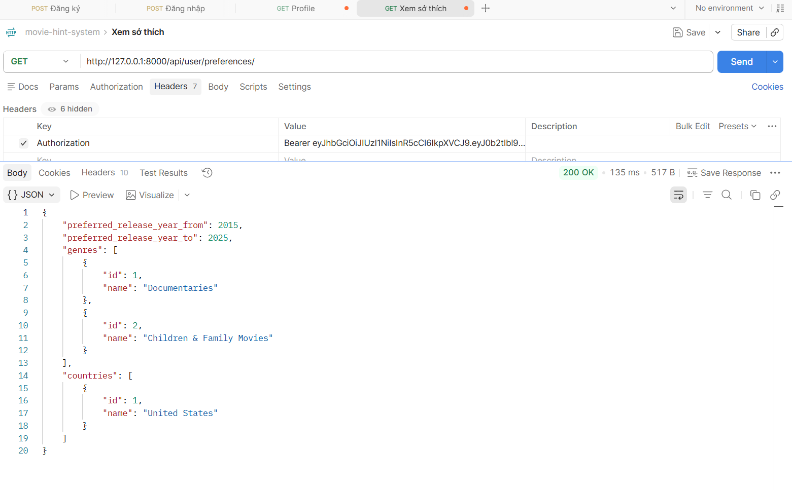
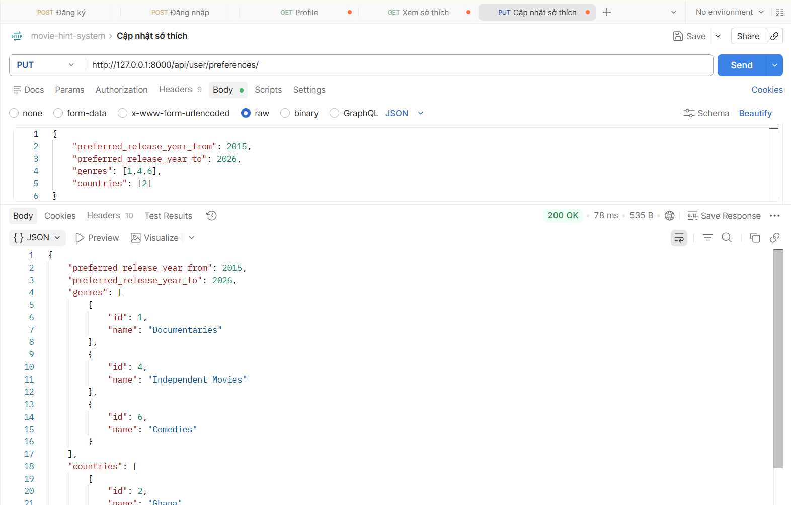

# API CURD PREFERENCES
## Xem thông tin sở thích của người dùng
1. Mô tả:
- Đây là api dùng cho mục đích xem thông tin sở thích của người dùng

2. Endpoint - Method: GET /api/user/preferences/
3. Input/output data:
- Output:
{
    "preferred_release_year_from": 2015,
    "preferred_release_year_to": 2025,
    "genres": [
        {
            "id": 1,
            "name": "Documentaries"
        },
        {
            "id": 2,
            "name": "Children & Family Movies"
        }
    ],
    "countries": [
        {
            "id": 1,
            "name": "United States"
        }
    ]
}

-> Lấy thông tin sở thích

## Cập nhật sở thích 
1. Mô tả:
- Đây là api dùng cho mục đích cập nhật sở thích

2. Endpoint - Method: PUT /api/user/preferences/ (giao diện thiết kế cho chỉnh 1 lúc nhiều trường)
3. Input/output data:
- Input:
{
    "preferred_release_year_from": 2015,
    "preferred_release_year_to": 2026,
    "genres": [1,4,6],
    "countries": [2]
}
- Output:
{
    "preferred_release_year_from": 2015,
    "preferred_release_year_to": 2026,
    "genres": [
        {
            "id": 1,
            "name": "Documentaries"
        },
        {
            "id": 4,
            "name": "Independent Movies"
        },
        {
            "id": 6,
            "name": "Comedies"
        }
    ],
    "countries": [
        {
            "id": 2,
            "name": "Ghana"
        }
    ]
}

-> Cập nhật thông tin sở thích

