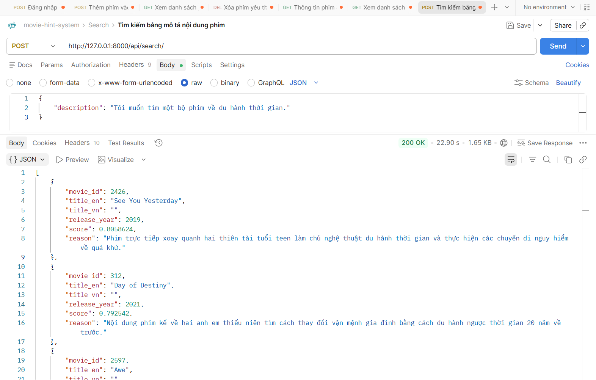

# API SEARCH MOVIE_CONTENT
## Tìm kiếm phim:
1. Mô tả:
- Đây là api dùng cho mục đích tìm kiếm phim dựa trên mô tả nội dung phim.

2. Endpoint - Method:
- GET api/search/

3. Input/output data:
- Input:
{
    "description": "Tôi muốn tìm một bộ phim về du hành thời gian."
}

- Output:
[
    {
        "movie_id": 2426,
        "title_en": "See You Yesterday",
        "title_vn": "",
        "release_year": 2019,
        "score": 0.8058624,
        "reason": "Phim trực tiếp xoay quanh hai thiên tài tuổi teen làm chủ nghệ thuật du hành thời gian và thực hiện các chuyến đi nguy hiểm về quá khứ."
    },
    {
        "movie_id": 312,
        "title_en": "Day of Destiny",
        "title_vn": "",
        "release_year": 2021,
        "score": 0.792542,
        "reason": "Nội dung phim kể về hai anh em thiếu niên tìm cách thay đổi vận mệnh gia đình bằng cách du hành ngược thời gian 20 năm về trước."
    },
    {
        "movie_id": 2597,
        "title_en": "Awe",
        "title_vn": "",
        "release_year": 2018,
        "score": 0.79812527,
        "reason": "Bộ phim quy tụ những nhân vật có sự kết nối bất ngờ, trong đó có một nhân vật đang khao khát trở thành người du hành thời gian."
    },
    {
        "movie_id": 2350,
        "title_en": "Cities of Last Things",
        "title_vn": "",
        "release_year": 2018,
        "score": 0.78294945,
        "reason": "Câu chuyện viễn tưởng được kể theo dòng thời gian đảo ngược, liên quan đến những sự kiện và thù oán từ nhiều thập kỷ trước."
    },
    {
        "movie_id": 1575,
        "title_en": "Forensic",
        "title_vn": "",
        "release_year": 2020,
        "score": 0.7827401,
        "reason": "Phim xoay quanh cuộc đua với thời gian của các sĩ quan cảnh sát khi giải mã các manh mối từ quá khứ để vây bắt thủ phạm."
    }
]

